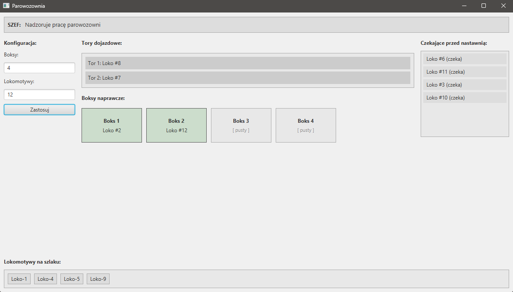
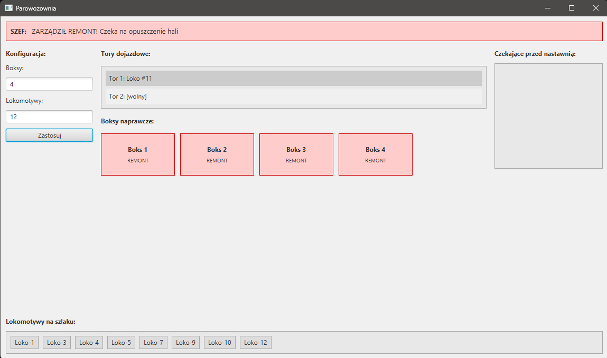
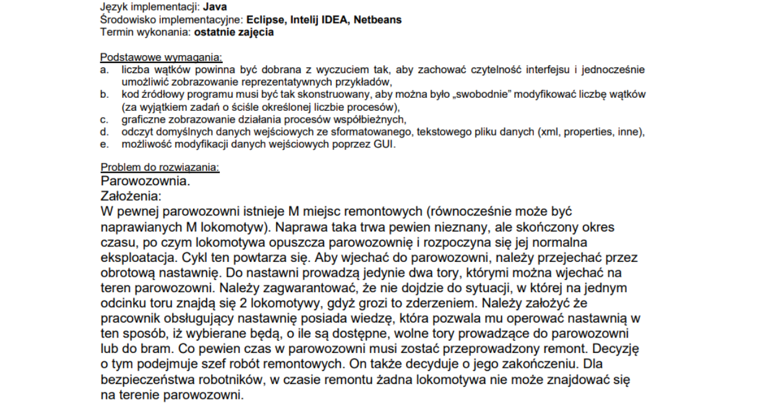

# Parowozownia – Symulacja Współbieżnych Procesów w JavaFX

System modeluje pracę parowozowni jako problem synchronizacji współbieżnych procesów. Wiele lokomotyw (wątków) cyklicznie korzysta ze wspólnych, ograniczonych zasobów: torów dojazdowych i boksów naprawczych. Dodatkowo istnieje proces nadrzędny (Szef), który może w dowolnym momencie zażądać wyłącznego dostępu do całej hali w celu przeprowadzenia generalnego remontu.




<details>
<summary><b>Treść zadania</b></summary>
<br>


</details>

---

## Opis problemu i przyjęte założenia

- Liczba lokomotyw **N** oraz liczba boksów **M** są konfigurowalne (plik `config.properties` oraz GUI). Domyślnie: `N=8` lokomotyw, `M=4` boksy.
- Każdy boks naprawczy mieści dokładnie 1 lokomotywę jednocześnie.
- Do parowozowni prowadzą dokładnie 2 tory dojazdowe przez nastawnię. Na jednym torze dojazdowym może znajdować się co najwyżej 1 lokomotywa w danej chwili.
- `DepotManager.acquireTrack()` przydziela lokomotywie pierwszy wolny tor. Jeśli oba są zajęte, lokomotywa oczekuje w kolejce przed nastawnią.
- Czas naprawy w boksie oraz czas pracy na szlaku są losowe.
- Szef może zarządzić remont w dowolnym momencie. Po ogłoszeniu zamiaru remontu żadna nowa lokomotywa nie może wjechać do hali flaga `renovationIntent`.
- Remont rozpoczyna się dopiero, gdy hala jest całkowicie pusta `locosInside == 0`. W czasie remontu `renovationInProgress == true` żadna lokomotywa nie wjeżdża do hali.
- Lokomotywy oczekujące na torach dojazdowych w trakcie ogłoszenia remontu mogą wjechać do hali dopiero po jego zakończeniu. Po zakończeniu remontu wszystkie oczekujące lokomotywy mogą wznowić wjazd.

---

## Procesy sekwencyjne i współdzielone zasoby

### Własne procesy sekwencyjne (Wątki)
1. **`Locomotive` (`klasa Locomotive implements Runnable`)** – wątek reprezentujący pojedynczą lokomotywę.  
   **Cykl życia wątku:**  
   `1. Praca na szlaku (Thread.sleep 4000–10000 ms)` ➔ `2. Oczekiwanie przed nastawnią (acquireTrack() - blokada jeśli oba tory zajęte)` ➔ `3. Przejazd torem dojazdowym (Thread.sleep 1500 ms)` ➔ `4. Oczekiwanie na wjazd do hali (enterDepotFromTrack() - blokada jeśli remont lub brak wolnych boksów)` ➔ `5. Naprawa w boksie (Thread.sleep 3000–7000 ms)` ➔ `6. Wyjazd z hali (exitDepot())` i powrót do punktu 1.

2. **`Boss` (`klasa Boss implements Runnable`)** – wątek reprezentujący szefa robót remontowych.  
   **Cykl życia wątku:**  
   `1. Nadzór normalnej pracy (Thread.sleep 15000–30000 ms)` ➔ `2. Ogłoszenie zamiaru remontu (startRenovation() - czeka aż hala opustoszeje)` ➔ `3. Generalny remont (Thread.sleep 6000 ms)` ➔ `4. Zakończenie remontu (endRenovation() - odblokowuje wjazd lokomotyw)` i powrót do punktu 1.

### Współdzielone zasoby (zarządzane przez `DepotManager`)
- **`spots[]` (`Locomotive[M]`)** – tablica boksów naprawczych. Każdy indeks reprezentuje jeden boks. Dostęp: wszystkie wątki `Locomotive` (zapis przy wjeździe i wyjeździe).
- **`accessTracks[]` (`Locomotive[2]`)** – tablica dwóch torów dojazdowych przez nastawnię. Dostęp: wszystkie wątki `Locomotive` (zajęcie toru przy wjeździe, zwolnienie przy przejściu do boksu).
- **`waitingQueue` (`List`)** – kolejka lokomotyw oczekujących przed nastawnią na wolny tor. Dostęp: wszystkie wątki `Locomotive`.
- **`locosInside` (`int`)** – licznik lokomotyw aktualnie przebywających na terenie hali (w boksach). Dostęp: wątki `Locomotive` (inkrementacja/dekrementacja), wątek `Boss` (odczyt przy oczekiwaniu na pustą halę).
- **`renovationIntent` (`boolean`)** – flaga sygnalizująca zamiar przeprowadzenia remontu. Ustawiana przez `Boss`, odczytywana przez `Locomotive` przy próbie wjazdu.
- **`renovationInProgress` (`boolean`)** – flaga sygnalizująca trwający remont. Ustawiana i zerowana przez `Boss`, odczytywana przez GUI.

---

## Punkty i obiekty synchronizacji

### Wyróżnione punkty synchronizacji
1. **Oczekiwanie na wolny tor dojazdowy (`acquireTrack`):**  
   Lokomotywa czeka, gdy oba tory są zajęte.
   - **Warunek wejścia:** `accessTracks[0] == null` LUB `accessTracks[1] == null`
   - **Akcja:** przydzielenie pierwszego wolnego toru, usunięcie z kolejki oczekujących.
2. **Oczekiwanie na wjazd do boksu (`enterDepotFromTrack`):**  
   Lokomotywa (stojąca już na torze) czeka, gdy ogłoszono zamiar remontu (`renovationIntent == true`) LUB brak wolnych boksów (`getFreeSpotIndex() == -1`).
   - **Akcja:** zajęcie boksu, inkrementacja `locosInside`, zwolnienie toru dojazdowego.
3. **Wyjazd z boksu po naprawie (`exitDepot`):**  
   Lokomotywa zwalnia boks i dekrementuje `locosInside`.
   - **Akcja:** `notifyAll()` — budzi Szefa (jeśli czeka na pustą halę) oraz inne lokomotywy (jeśli czekają na wolny boks).
4. **Oczekiwanie Szefa na pustą halę (`startRenovation`):**  
   Boss ustawia `renovationIntent = true`, następnie czeka aż `locosInside == 0`.
   - **Warunek wejścia:** `locosInside == 0`
   - **Akcja:** ustawienie `renovationInProgress = true`, rozpoczęcie remontu.
5. **Zakończenie remontu i otwarcie bram (`endRenovation`):**  
   Boss zeruje obie flagi i wywołuje `notifyAll()`.
   - **Akcja:** odblokowanie wszystkich lokomotyw oczekujących na wjazd do hali.

### Obiekty synchronizacji
- **Monitor obiektu `DepotManager` (`synchronized` + `wait()` / `notifyAll()`):** Główny mechanizm synchronizacji całego systemu. Metody synchronizowane: `acquireTrack()`, `enterDepotFromTrack()`, `exitDepot()`, `startRenovation()`, `endRenovation()` oraz gettery stanu (`getLocomotiveAtSpot`, `getLocomotiveOnTrack`, `isRenovationInProgress`, `isRenovationIntent`).
- **`wait()`:** Stosowane w `acquireTrack()` (oczekiwanie na wolny tor), `enterDepotFromTrack()` (oczekiwanie na koniec remontu lub wolny boks) oraz `startRenovation()` (oczekiwanie Szefa na opuszczenie hali).
- **`notifyAll()`:** Stosowane w `enterDepotFromTrack()` (po zwolnieniu toru — inne lokomotywy mogą wjechać), `exitDepot()` (po zwolnieniu boksu — Szef lub inne lokomotywy) oraz `endRenovation()` (po remoncie — wszystkie oczekujące lokomotywy).
- **`volatile boolean running` (`ParowozowniaApp`):** Flaga sterująca pętlą wątku odświeżającego GUI, zapewnia widoczność między wątkami bez pełnej synchronizacji.
- **`Collections.synchronizedList` (`waitingQueue` w `DepotManager`):** Bezpieczna wątkowo lista kolejki oczekujących lokomotyw przed nastawnią (wyłącznie do celów wizualizacji w GUI).
- **`synchronized getStatus()` (`Boss`) oraz `synchronized getStateDescription()` (`Locomotive`):** Ochrona odczytu pól `status` oraz `stateDescription` przez wątek GUI.

---

## Pliki źródłowe projektu (pakiet: `parowozownia`)

| Plik | Opis |
| :--- | :--- |
| `Launcher.java` | Punkt wejścia, uruchamia aplikację JavaFX. |
| `ParowozowniaApp.java` | Główna klasa aplikacji, GUI (JavaFX), zarządzanie wątkami. |
| `DepotManager.java` | Zarządzanie zasobami, cała logika synchronizacji. |
| `Locomotive.java` | Wątek lokomotywy, cykl: szlak → naprawa → szlak. |
| `Boss.java` | Wątek szefa, zarządza remontami generalnymi. |
| `ConfigManager.java` | Odczyt/zapis konfiguracji z pliku `config.properties`. |

---

## Konfiguracja i uruchomienie

Domyślne dane wejściowe są wczytywane z pliku `config.properties`:
```properties
locomotives=8
depot_spots=4